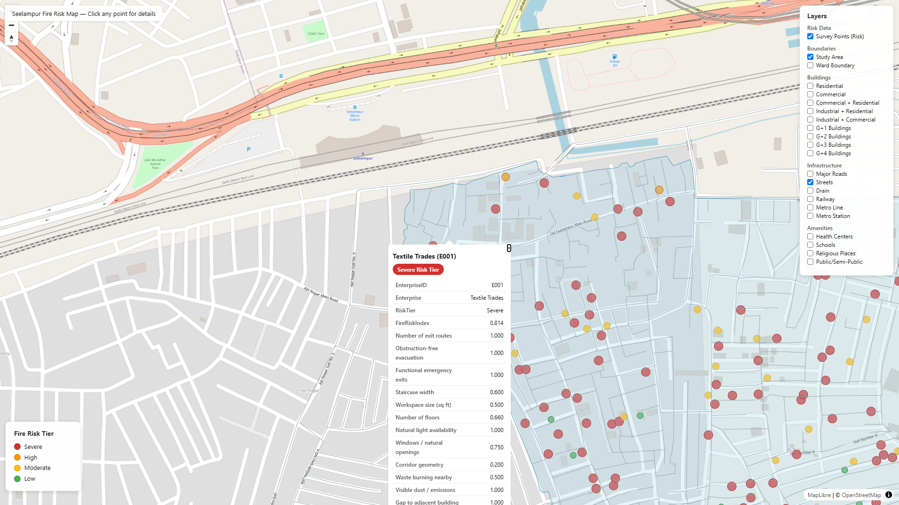
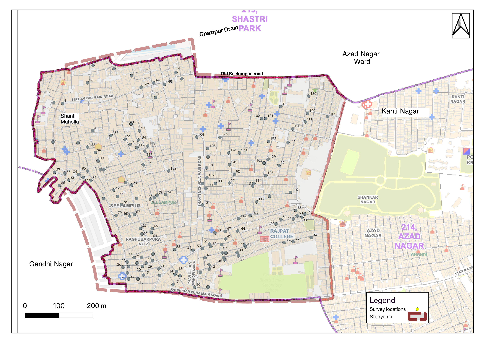
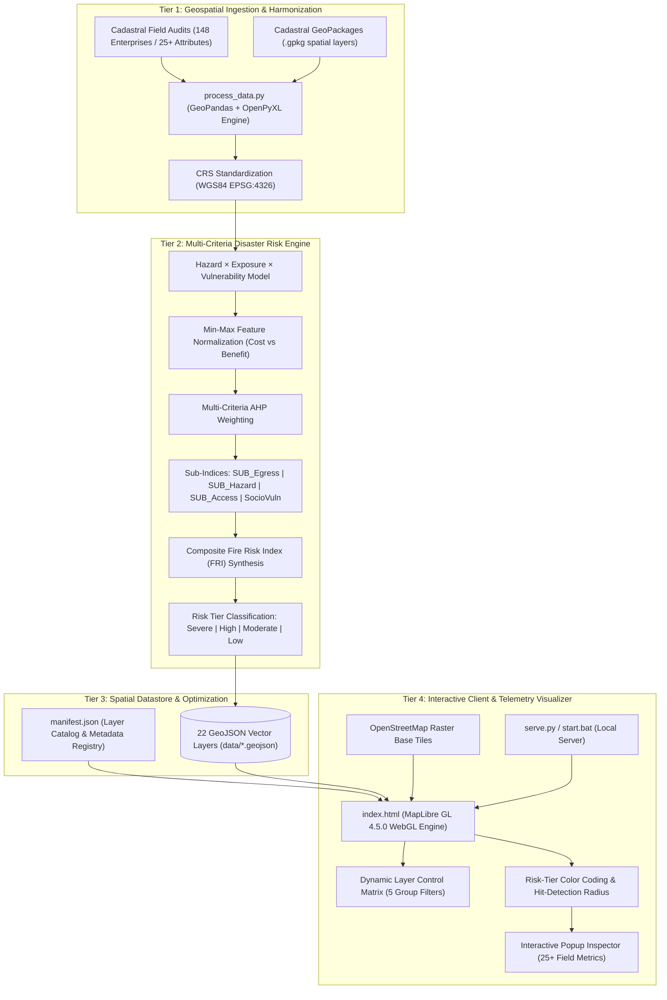

# Geospatial Fire Risk Analysis & Disaster Vulnerability Platform

An interactive Web GIS platform and multi-criteria spatial risk assessment engine designed to quantify, evaluate, and visualize structural fire hazards in high-density informal urban settlements. Developed using **MapLibre GL**, **GeoPandas**, and **OpenStreetMap**, with an empirical field case study conducted across Seelampur (North East Delhi).


[](https://render.com/deploy?repo=https://github.com/DhruvBasia/geospatial-fire-risk-analysis)

---

## Visual Showcase

### Live Web GIS Interface & Enterprise Telemetry Inspector
The platform renders color-coded spatial risk markers over cadastral parcel footprints, featuring real-time layer toggles, risk tier legends, and an on-click enterprise vulnerability inspector displaying comprehensive field telemetry.



### Cadastral Field Survey & Study Area Map (Seelampur, Delhi)
Detailed spatial mapping showing 148 surveyed micro-enterprise locations, primary road networks, inner streets, drainage channels, and municipal boundaries.



---

## Overview

High-density informal urban settlements represent high-vulnerability disaster environments: extreme structural density, absence of spatial setbacks between adjoining buildings, narrow alleyways inaccessible to standard hydraulic fire tenders, and mixed industrial-residential fabric.

This platform operationalizes field-based disaster risk reduction (DRR) by translating multi-parameter physical audits into an analytical Web GIS interface. Analyzing **148 audited micro-enterprises** across 22 spatial layers in Seelampur, Delhi, the platform computes a composite **Fire Risk Index (FRI)**, evaluates dimensional sub-indices (Egress, Hazard, Emergency Access, Socio-Vulnerability), and serves vector-mapped risk intelligence in the browser.

---

## Technical System Architecture

The platform is designed as a four-tier decoupled architecture separating geospatial ETL, multi-criteria mathematical modeling, static vector optimization, and client-side WebGL map rendering.



---

## Mathematical Formulation & Risk Science

### 1. Foundational Hazard Formulation

Following international disaster risk science frameworks (UNDRR):

$$\text{Risk} = \text{Hazard} \times \text{Exposure} \times \text{Vulnerability}$$

Where:
- **Hazard ($\mathcal{H}$)**: The physical probability and thermal intensity of a fire ignition.
- **Exposure ($\mathcal{E}$)**: Physical assets, building floors, occupant density, and land-use activities present in the hazard zone.
- **Vulnerability ($\mathcal{V}$)**: The structural susceptibility of assets and physical impedance to safe evacuation and emergency fire suppression.

---

### 2. Multi-Criteria Composite Fire Risk Index (FRI)

Each surveyed enterprise $i$ is evaluated across a multi-attribute weighted synthesis of four core sub-indices:

$$\text{FRI}_i = w_E \cdot \text{SUB}_{\text{Egress}, i} + w_H \cdot \text{SUB}_{\text{Hazard}, i} + w_A \cdot \text{SUB}_{\text{Access}, i} + w_S \cdot \text{SocioVuln}_i$$

$$\text{Subject to:} \quad \sum_{k \in \{E, H, A, S\}} w_k = 1.0, \quad w_k > 0$$

Where normalized weights are derived via multi-attribute decision weighting:
- $w_E = 0.35$ (Egress Vulnerability — primary contributor to occupant mortality)
- $w_H = 0.25$ (Physical & Environmental Hazard Load)
- $w_A = 0.25$ (Emergency Fire Response Accessibility)
- $w_S = 0.15$ (Socio-Demographic & Operational Vulnerability)

---

### 3. Dimensional Sub-Index Formulations

#### A. Egress Vulnerability Sub-Index ($\text{SUB}_{\text{Egress}}$)
Quantifies evacuation capacity and escape bottlenecks during flashover:

$$\text{SUB}_{\text{Egress}, i} = \frac{1}{4} \left( f_{\text{exit}}(x_1) + f_{\text{obstruct}}(x_2) + f_{\text{em\_exit}}(x_3) + f_{\text{stair}}(x_4) \right)$$

- $x_1$: Number of distinct exit routes ($1 \implies 1.0$, $\ge 2 \implies 0.0$)
- $x_2$: Presence of obstruction in corridors/evacuation paths (binary: $1.0$ obstructed, $0.0$ clear)
- $x_3$: Functional emergency exits available (binary penalty)
- $x_4$: Staircase width ($< 0.8\text{m} \implies 1.0$, $0.8\text{m} - 1.2\text{m} \implies 0.6$, $> 1.2\text{m} \implies 0.2$)

#### B. Hazard Load Sub-Index ($\text{SUB}_{\text{Hazard}}$)
Measures structural fuel load and fire propagation risk to adjoining units:

$$\text{SUB}_{\text{Hazard}, i} = \frac{1}{6} \left( f_{\text{space}}(x_5) + f_{\text{floors}}(x_6) + f_{\text{gap}}(x_7) + f_{\text{vent}}(x_8) + f_{\text{dust}}(x_9) + f_{\text{burn}}(x_{10}) \right)$$

- $x_5$: Workspace size ($\text{sq ft}$) relative to occupant density
- $x_6$: Number of vertical floors ($G+1$ to $G+4$ structural height loading)
- $x_7$: Physical gap to adjacent building ($0\text{m} \implies 1.0$ party wall, $> 1.5\text{m} \implies 0.0$)
- $x_8$: Natural ventilation and window openings ratio
- $x_9$: Presence of combustible airborne dust, fabric lint, or chemical fumes
- $x_{10}$: Open waste burning proximity within $50\text{m}$ radius

#### C. Emergency Access Sub-Index ($\text{SUB}_{\text{Access}}$)
Evaluates external suppression response delays:

$$\text{SUB}_{\text{Access}, i} = \frac{1}{2} \left( f_{\text{dist}}(x_{11}) + f_{\text{road}}(x_{12}) \right)$$

- $x_{11}$: Distance to the nearest operational fire station ($> 3\text{km} \implies 1.0$)
- $x_{12}$: Approach road width for fire tenders ($< 3.5\text{m} \implies 1.0$, impassable for major tenders)

#### D. Socio-Demographic & Operational Vulnerability ($\text{SocioVuln}$)
Measures human exposure and internal suppression capability:

$$\text{SocioVuln}_i = \frac{1}{4} \left( f_{\text{hours}}(x_{13}) + f_{\text{occupancy}}(x_{14}) + f_{\text{water}}(x_{15}) + f_{\text{health}}(x_{16}) \right)$$

- $x_{13}$: Daily operating hours ($> 12\text{ hours/day} \implies 1.0$)
- $x_{14}$: Peak daily occupancy density (workers + visitors)
- $x_{15}$: Daily municipal water supply availability ($< 2\text{ hours/day} \implies 1.0$)
- $x_{16}$: Incidence of chronic respiratory or health conditions among workers

---

### 4. Feature Normalization (Cost vs. Benefit Functions)

Raw indicators are mapped onto a standardized continuous scale $[0, 1]$ using directional min-max transformations:

$$\text{For Hazard / Cost Factors:} \quad f(x) = \frac{x - x_{\min}}{x_{\max} - x_{\min}}$$

$$\text{For Protective / Benefit Factors:} \quad f(x) = \frac{x_{\max} - x}{x_{\max} - x_{\min}}$$

---

## Empirical Results & Dataset Analysis

The model was executed across the complete survey dataset ($N = 148$ evaluated micro-enterprises and parcels in Seelampur, Delhi).

### 1. Risk Tier Distribution ($N = 148$)

| Risk Tier | Index Threshold | Enterprise Count ($n$) | Proportion (%) | Primary Physical Characteristics |
| :--- | :--- | :--- | :--- | :--- |
| **Severe** | $\text{FRI} \ge 0.700$ | **106** | **71.62%** | Single exit, staircase $< 0.8\text{m}$, party-wall adjacency, impassable alleyway. |
| **High** | $0.600 \le \text{FRI} < 0.700$ | **4** | **2.70%** | Moderate egress constraints, high combustible storage, limited water access. |
| **Moderate** | $0.400 \le \text{FRI} < 0.600$ | **29** | **19.59%** | Multi-exit access, partial ventilation, wider connecting streets. |
| **Low** | $\text{FRI} < 0.400$ | **9** | **6.08%** | Wide street frontage ($> 6\text{m}$), ground-floor egress, non-hazardous occupancy. |

```
Risk Tier Proportion:
[████████████████████████████████████████     ] Severe:   71.6% (106)
[█                                            ] High:      2.7% (4)
[██████████                                   ] Moderate: 19.6% (29)
[███                                          ] Low:       6.1% (9)
```

---

### 2. Sub-Indices Statistical Summary

| Evaluated Dimension | Mean ($\mu$) | Min | Max | Primary Critical Bottleneck Observed |
| :--- | :--- | :--- | :--- | :--- |
| **$\text{SUB}_{\text{Egress}}$ (Egress Vulnerability)** | **0.7207** | 0.2500 | 1.0000 | 89.2% of facilities possess only a single egress route. |
| **$\text{SUB}_{\text{Hazard}}$ (Hazard Load)** | **0.7128** | 0.2000 | 0.9500 | 76.4% lack physical fire separation gaps between adjoining units. |
| **$\text{SUB}_{\text{Access}}$ (Emergency Response Access)** | **0.6752** | 0.1000 | 1.0000 | 68.9% of interior streets measure under $3.0\text{m}$ in width. |
| **$\text{SocioVuln}$ (Socio-Demographic Vulnerability)** | **0.6099** | 0.1500 | 0.9000 | Average daily working shifts exceed 11.4 hours in confined spaces. |
| **Composite $\text{FRI}$ (Fire Risk Index)** | **0.7051** | **0.2882** | **0.9500** | Overall settlement-wide vulnerability remains in the Severe bracket. |

---

### 3. Audited Enterprise Risk Profile Showcase

The platform allows granular inspection of individual audited facilities. Below is the profile of an audited textile manufacturing enterprise (`E001`), demonstrating how field variables populate the interactive telemetry inspector:

| Telemetry Parameter | Recorded Field Value | Normalized Score | Vulnerability Interpretation |
| :--- | :--- | :--- | :--- |
| **Enterprise ID** | `E001` | — | Unique cadastral identification code |
| **Enterprise Classification** | `Textile Trades` | — | Fabric cutting, storage, and garment finishing |
| **Assigned Risk Tier** | **Severe Risk** | — | Critical priority for municipal fire mitigation |
| **Composite Fire Risk Index** | **0.814** | `0.814` | High vulnerability composite index |
| **Number of Exit Routes** | `1` | `1.000` | Single point of escape; extreme bottleneck hazard |
| **Obstruction-Free Evacuation** | Obstructed | `1.000` | Corridors used for inventory and fabric storage |
| **Functional Emergency Exits** | None | `1.000` | Zero secondary exits or external fire stairs |
| **Staircase Width** | $0.75\text{ m}$ | `0.600` | Below National Building Code minimum ($1.5\text{m}$) |
| **Workspace Area** | $450\text{ sq ft}$ | `0.500` | High equipment and worker density per unit area |
| **Number of Floors** | $G+3$ (4 levels) | `0.660` | High vertical evacuation delay |
| **Natural Light / Openings** | Limited | `1.000` | Heavy smoke trapping risk during combustion |
| **Gap to Adjacent Structure** | $0.0\text{ m}$ (Shared Wall) | `1.000` | 100% horizontal fire propagation probability |
| **Distance to Fire Station** | $2.4\text{ km}$ | `0.800` | Response delay exacerbated by traffic congestion |
| **Approach Road for Fire Truck** | Inaccessible ($< 2.5\text{m}$) | `1.000` | Heavy fire tenders cannot enter the lane |
| **Daily Operating Shift** | $12\text{ hours/day}$ | `0.500` | Prolonged human exposure to electrical hazards |
| **Municipal Water Supply** | $1.5\text{ hours/day}$ | `0.800` | Zero localized pressurized water for suppression |

---

## Spatial Data Catalog (22 GeoJSON Layers)

The platform organizes geospatial vector layers into 5 functional thematic categories:

```
data/
├── manifest.json                # Complete layer metadata and configuration
├── survey_points.geojson        # 148 audited enterprise centroids with merged FRI telemetry
├── study_area.geojson           # Seelampur study area polygon boundary
├── ward_boundary.geojson        # Municipal administrative ward boundaries
├── residential.geojson          # Residential parcel footprints
├── commercial.geojson           # Dedicated commercial structures
├── com_res.geojson              # Mixed commercial-residential buildings
├── ind_res.geojson              # Mixed industrial-residential units
├── ind_com.geojson              # Mixed industrial-commercial units
├── public_semi_public.geojson   # Government, community, and public parcels
├── g_plus_1.geojson             # Ground + 1 storey buildings
├── g_plus_2.geojson             # Ground + 2 storey buildings
├── g_plus_3.geojson             # Ground + 3 storey buildings
├── g_plus_4.geojson             # Ground + 4 storey buildings
├── roads.geojson                # Primary arterial thoroughfares
├── streets.geojson              # Secondary and tertiary street network
├── drain.geojson                # Ghazipur drainage channel
├── railway.geojson              # Northern Railway track corridor
├── metro_line.geojson           # Delhi Metro Red Line alignment
├── metro_station.geojson        # Metro station access nodes
├── health_centers.geojson       # Hospitals, clinics, and health centers
├── schools.geojson              # Primary and secondary educational facilities
└── religious_places.geojson     # Mosques, temples, and gathering locations
```

---

## Getting Started

### Prerequisites

- Modern Web Browser with WebGL support (Google Chrome, Mozilla Firefox, Microsoft Edge, Brave, or Safari).
- [Python 3.8+](https://www.python.org/) (optional, required only for local HTTP serving or data pipeline execution).

---

### Running the Web GIS Application

#### Option 1: One-Click Execution (Windows)
Double-click `start.bat` in the project root directory. This starts the Python local HTTP server and automatically opens the map in your default browser.

#### Option 2: Python HTTP Server (CLI)
From the root directory:

```bash
python serve.py
```

Alternatively, use Python's built-in HTTP server:

```bash
python -m http.server 8000
```

Navigate to `http://localhost:8000/index.html` in your web browser.

---

### Executing the Spatial ETL Pipeline (Optional)

To regenerate GeoJSON layers from raw field survey workbooks and GeoPackage (`.gpkg`) spatial geometries:

1. Install dependencies:
   ```bash
   pip install geopandas openpyxl shapely
   ```

2. Run the data ingestion script:
   ```bash
   python process_data.py
   ```

The script will re-align all spatial layers to WGS84, join survey enterprise metrics with point geometries, and populate the `data/` directory.

---

## Author

**Dhruv Basia**
- GitHub: [@DhruvBasia](https://github.com/DhruvBasia)

---

## License

This project is licensed under the [MIT License](LICENSE).
