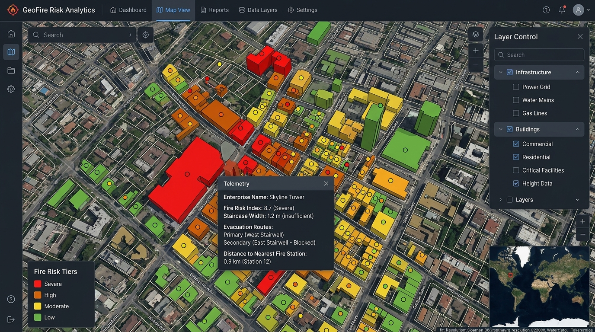
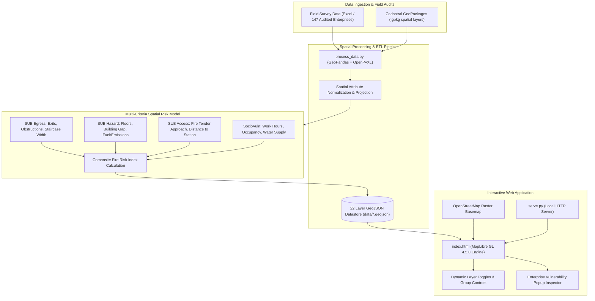

# Geospatial Fire Risk Analysis & Disaster Vulnerability Platform

An interactive Web GIS platform and multi-criteria spatial risk assessment engine designed to quantify, visualize, and analyze urban fire hazards in dense informal settlements. Developed using **MapLibre GL**, **GeoPandas**, and **OpenStreetMap**, with a case study focused on Seelampur, Delhi.


---

## Visual Showcase

### Interactive Web GIS Dashboard


### Study Area Cadastral Survey Map (Seelampur, Delhi)


---

## Overview

High-density informal urban settlements present critical disaster management challenges: extreme building proximity, narrow street networks inaccessible to standard fire tenders, mixed industrial-residential zoning, and inadequate emergency egress routes.

This platform bridges field-level structural audits with spatial analytics. It processes 147 cadastral survey locations and over 20 spatial GIS layers across Seelampur (North East Delhi), computing a composite **Fire Risk Index** for every enterprise and displaying actionable vulnerability telemetry in an interactive browser-based GIS interface.

---

## Key Features

- **Multi-Criteria Fire Risk Indexing**:
  - Classifies enterprises and structures into four tiered vulnerability categories: **Severe**, **High**, **Moderate**, and **Low**.
  - Evaluates 25+ spatial and operational indicators across egress safety, structural hazard, fire tender accessibility, and socio-demographic vulnerability.

- **Dynamic Layer Filtering & GIS Overlays**:
  - **Land Use & Zoning**: Residential, Commercial, Mixed Commercial-Residential, Mixed Industrial-Residential, Industrial-Commercial, and Public/Semi-Public parcels.
  - **Structural Typology & Building Heights**: Stratified height layers including $G+1$, $G+2$, $G+3$, and $G+4$ building footprints.
  - **Transportation & Accessibility**: Major roads, inner alleyway and street networks, railway corridors, metro lines, and drainage channels.
  - **Critical Amenities**: Health centers, schools, religious places, and metro stations for evacuation planning.

- **Enterprise Telemetry Inspector**:
  - Interactive click popups displaying building height, staircase width, evacuation route redundancy, natural lighting, distance to the nearest fire station, and predicted emergency response time.

- **Lightweight Zero-Dependency Web Architecture**:
  - Client-side MapLibre GL rendering powered by optimized GeoJSON vectors, requiring no heavy GIS server infrastructure (e.g., GeoServer or ArcGIS Enterprise) for standard inspection.

---

## System Architecture



---

## Methodology & Risk Scoring Model

The composite **Fire Risk Index** is derived through a multi-parameter spatial evaluation covering four primary vulnerability dimensions:

```
Fire Risk Index = w1(SUB_Egress) + w2(SUB_Hazard) + w3(SUB_Access) + w4(SocioVuln)
```

### Risk Sub-Indices Breakdown

| Sub-Index | Evaluated Factors | Weight / Significance |
| :--- | :--- | :--- |
| **$\text{SUB}_{\text{Egress}}$** | Number of exit routes, corridor geometry, obstruction-free pathways, functional emergency exits, and staircase width ($m$). | Evaluates survivability and immediate occupant evacuation capacity during flashover. |
| **$\text{SUB}_{\text{Hazard}}$** | Building height ($G+1$ to $G+4$), workspace area ($\text{sq ft}$), gaps between adjacent structures, adjacent waste burning, and natural ventilation. | Assesses fuel load, structural collapse probability, and fire propagation risk to adjoining units. |
| **$\text{SUB}_{\text{Access}}$** | Distance to nearest fire station ($\text{km}$), estimated fire tender travel time, and approach road width. | Measures external response feasibility and delays caused by narrow informal street widths. |
| **$\text{SocioVuln}$** | Daily operating hours, visitor density, daily water supply hours, and access to medical infrastructure. | Quantifies human exposure and local capacity to suppress fires prior to brigade arrival. |

### Classification Tiers

| Tier | Color Code | Description | Action Recommendation |
| :--- | :--- | :--- | :--- |
| **Severe** | `#D32F2F` | Critical hazard, narrow alleys, single exit, multi-story combustible load. | Immediate structural retrofitting, fire egress enforcement, and hydrant installation. |
| **High** | `#FF9800` | Elevated risk, limited access, moderate staircase constraints. | Routine safety inspection, localized fire extinguisher distribution. |
| **Moderate** | `#FFC107` | Intermediate risk, partial compliance with basic safety guidelines. | Periodic monitoring and community awareness drills. |
| **Low** | `#4CAF50` | Favorable egress, wider street access, and reduced combustible density. | Baseline maintenance and adherence to building standards. |

---

## Project Structure

```
geospatial-fire-risk-analysis/
├── assets/
│   ├── dashboard_preview.jpg        # High-resolution GIS web dashboard preview
│   └── survey_cadastral_map.png     # Official cadastral field survey map (Seelampur, Delhi)
├── data/
│   ├── manifest.json                # Layer catalog and metadata registry
│   ├── survey_points.geojson        # 147 audited enterprises with merged risk scores
│   ├── study_area.geojson           # Study boundary polygon
│   ├── ward_boundary.geojson        # Administrative ward boundary
│   ├── residential.geojson          # Residential parcel footprints
│   ├── commercial.geojson           # Commercial parcel footprints
│   ├── com_res.geojson              # Mixed commercial-residential buildings
│   ├── ind_res.geojson              # Mixed industrial-residential buildings
│   ├── ind_com.geojson              # Mixed industrial-commercial buildings
│   ├── g_plus_1.geojson             # Ground + 1 level structures
│   ├── g_plus_2.geojson             # Ground + 2 level structures
│   ├── g_plus_3.geojson             # Ground + 3 level structures
│   ├── g_plus_4.geojson             # Ground + 4 level structures
│   ├── roads.geojson                # Primary arterial roads
│   ├── streets.geojson              # Secondary and tertiary street network
│   ├── drain.geojson                # Drainage network (Ghazipur Drain)
│   ├── railway.geojson              # Railway corridor
│   ├── metro_line.geojson           # Metro transit alignment
│   ├── metro_station.geojson        # Transit station points
│   ├── health_centers.geojson       # Hospitals and clinics
│   ├── schools.geojson              # Educational institutions
│   └── religious_places.geojson     # Community gathering sites
├── index.html                       # MapLibre GL Single Page Application
├── process_data.py                  # GeoPandas ETL script for spatial processing
├── serve.py                         # Python local development web server
├── start.bat                        # Windows 1-click execution batch script
├── .gitignore                       # Exclusions for raw GIS files (.gpkg, .xlsx)
├── LICENSE                          # MIT License
└── README.md                        # Documentation
```

---

## Getting Started

### Prerequisites

- Modern Web Browser (Chrome, Firefox, Edge, Brave, or Safari with WebGL enabled)
- [Python 3.8+](https://www.python.org/) (optional, required only for local serving or ETL data processing)

---

### Running the Web Application

#### Option 1: 1-Click Launch (Windows)
Double-click `start.bat` in the project root directory. This launches a local server and opens the map in your default browser.

#### Option 2: Using Python HTTP Server
Navigate to the project root and start the server:

```bash
python serve.py
```

Or run the built-in HTTP server:

```bash
python -m http.server 8000
```

Open `http://localhost:8000/index.html` in your browser.

---

### Re-running the Data Processing Pipeline (Optional)

If you have raw survey spreadsheets or `.gpkg` layers and wish to re-generate the GeoJSON outputs:

1. Install geospatial dependencies:
   ```bash
   pip install geopandas openpyxl
   ```

2. Execute the data processor:
   ```bash
   python process_data.py
   ```

The script will ingest the spatial layers, merge the survey attributes with the risk index matrix, and output optimized GeoJSON files into the `data/` directory.

---

## Author

**Dhruv Basia**
- GitHub: [@DhruvBasia](https://github.com/DhruvBasia)

---

## License

This project is licensed under the [MIT License](LICENSE).
